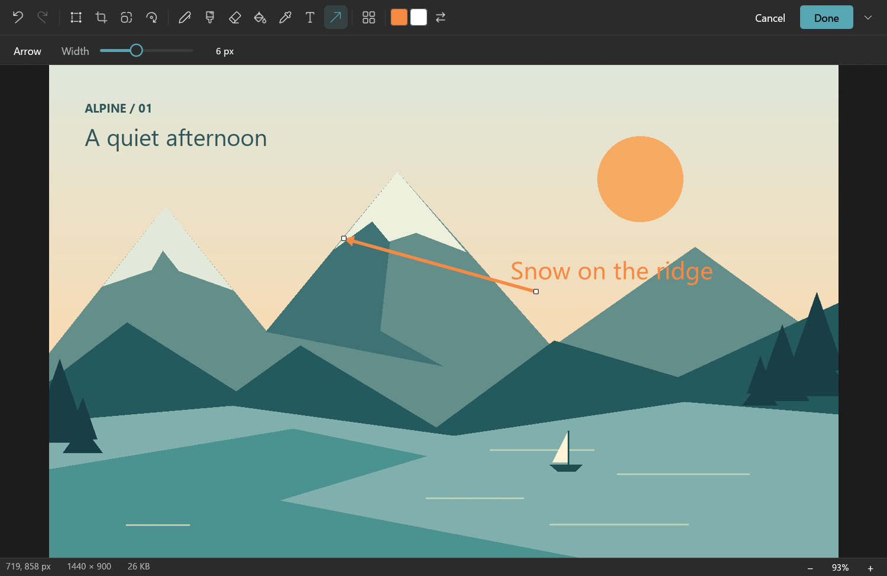
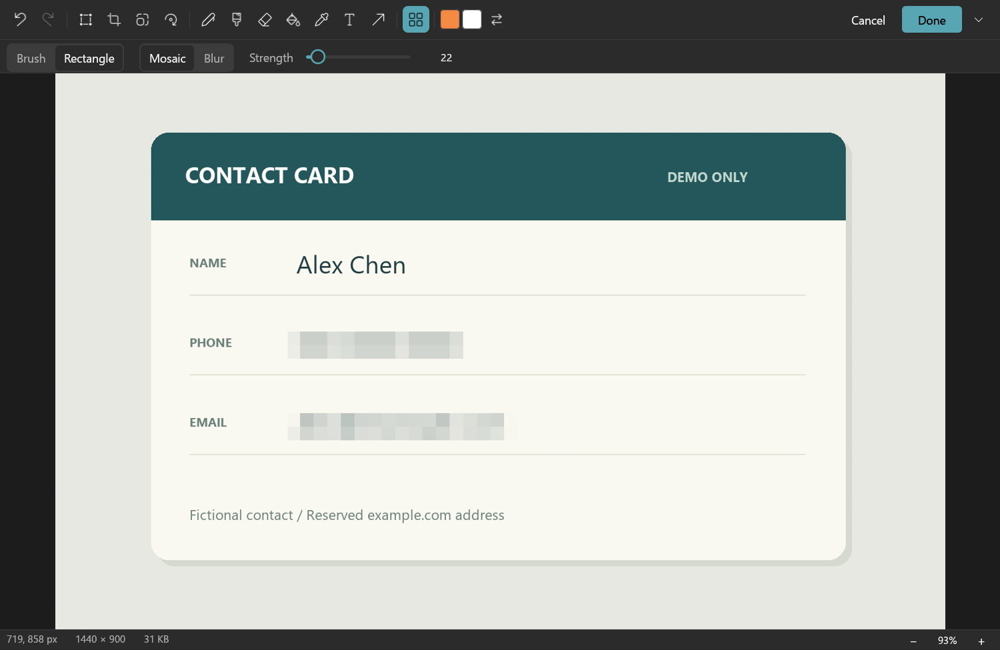

# LiteView

[简体中文](README.md) · **English**

[](LICENSE)
[](https://ifdian.net/a/lianzy)

A lightweight image viewer written in Rust: browse a folder, zoom with the mouse wheel, play GIFs and step through them frame by frame.
It comes with a Paint-style editor and mosaic / blur / smudge redaction by brush or box. The flat, modern interface is in English and Chinese and follows the system's language and light or dark theme; change the language in Settings → General.

> Windows is the main platform for viewing, editing and redaction. Install from the [Microsoft Store](https://apps.microsoft.com/detail/9PCG7D394JFC) or [GitHub Releases](https://github.com/Lianzy-Baimiao/LiteView/releases/latest). What changed in each version is in the [changelog](docs/CHANGELOG.md) (Chinese); what is still to be done is in [TODO](docs/TODO.md) (Chinese).

## Screenshots

These come from the released Windows 1.0.0 (2026-10-17), not from design mockups; in later versions the toolbar stays hidden until needed, and some buttons and menus have changed.
The pictures are original demo material and the data card is fictional; the text, arrow and mosaic were all made in LiteView. [Screenshot sources and how to reproduce them](docs/images/store-v1.0.0/README.md) (Chinese)

### Viewing · dark theme

The image comes first: the floating toolbar for browsing, zoom, rotation and editing appears when the mouse reaches the bottom of the window.


### Editing · text and arrows

Edit in the same window: add text, draw an arrow and adjust the shape's handles.



### Redaction · box mosaic

Select the area to hide. Switch between brush and box, and between mosaic, blur and smudge, and set the strength.



### Animation · pause and step through frames

Pause a GIF, step backward and forward one frame at a time, or export the current frame.


## Features

- Viewing: browse the folder (hold to keep going), wheel zoom, lock zoom, full screen, always on top; on Windows also a borderless mode (the window is the size of the image) and printing.
- Animation: GIF / APNG / animated WebP play automatically, with speed control, frame stepping and current-frame export; large animations beyond the cache are decoded on demand in the background. On Windows, transparent WebM stickers open once the system's VP9 Video Extensions are installed.
- Formats: common bitmaps, SVG (redrawn at screen resolution when zoomed in, so it stays sharp), JPEG XL, embedded RAW previews, flattened PSD; HEIC / AVIF and others depend on system codec extensions on Windows. Not every file opens unconditionally.
- Editing: crop, resize, rotate, shapes, text, brushes, undo / redo; animations are view-only.
- Redaction: mosaic, blur and smudge, by brush or box. Saving re-encodes the image and strips EXIF, thumbnails and other data that could reveal the original; overwriting asks first and writes atomically.
- Offline at run time, no ads, no background service; MIT open source.

## Download and platforms

[Microsoft Store](https://apps.microsoft.com/detail/9PCG7D394JFC) · [Latest release](https://github.com/Lianzy-Baimiao/LiteView/releases/latest) · [All releases](https://github.com/Lianzy-Baimiao/LiteView/releases) · [Installation](docs/INSTALL.md#english-quick-start) · [Privacy policy](docs/PRIVACY.md#english)

- Windows 10 / 11 x64 comes first. The Store version is signed by Microsoft and updates automatically; a new version reaches it only after Microsoft's review, usually a few hours to a few days after GitHub.
- GitHub Releases has a portable Windows build and a per-user installer (no administrator rights needed), plus packages for Linux x64 and macOS Intel / Apple Silicon. The Linux and macOS packages are built and unit-tested by CI but have not been fully tested on real machines.
- Release packages include third-party licenses and SHA-256 checksums. The GitHub packages are not code-signed and the macOS package is not notarized, so the system may block the first launch; see the installation notes.

## Shortcuts

| Action | Shortcut |
|---|---|
| Open / paste | Ctrl+O / Ctrl+V |
| Previous / next image | ← / → (hold to keep going) |
| Fit to window / actual size | Ctrl+0 / Ctrl+1 |
| Full screen / borderless (Windows) | F11 / Ctrl+B |
| Edit / redact | E / M |
| Copy image / save | Ctrl+C / Ctrl+S |
| Print (Windows) | Ctrl+P |
| Play or pause animation / previous or next frame | Space / , / . |
| Image info / close the window | I / Esc |

All shortcuts are listed in Settings → Shortcuts.

## Building from source

Rust 1.95+; the current stable toolchain is recommended.

- On Windows, the MSVC toolchain with Visual Studio C++ Build Tools is recommended; for GNU/MinGW local paths, see [.cargo/config.example.toml](.cargo/config.example.toml).
- Build dependencies on Ubuntu:

```sh
sudo apt-get install libxkbcommon-dev libwayland-dev libxcb-render0-dev libxcb-shape0-dev libxcb-xfixes0-dev
```

```sh
cargo test --locked --release --lib
cargo clippy --locked --release --all-targets -- -D warnings
cargo build --locked --release
```

Releasing and local packaging are described in [RELEASING](docs/RELEASING.md) (Chinese).

## License

[MIT](LICENSE). Third-party dependencies and icons retain their own licenses;
see [third-party notices](THIRD-PARTY-NOTICES.md) and the generated LICENSES.html in release packages.
