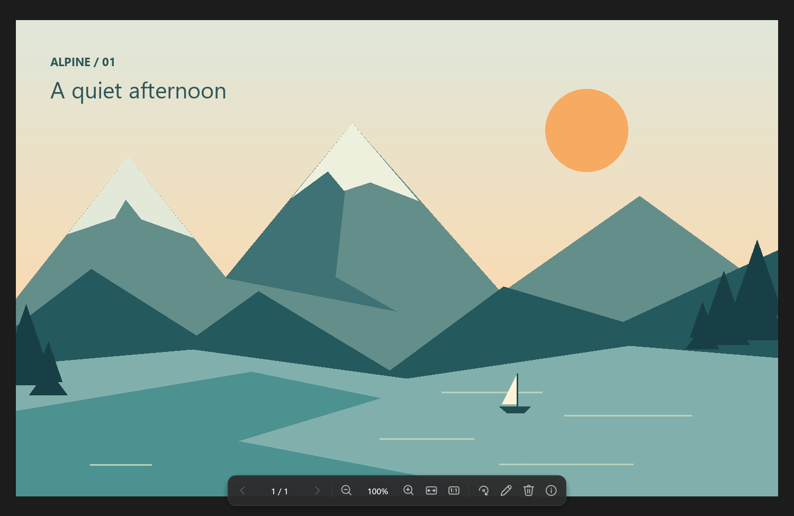
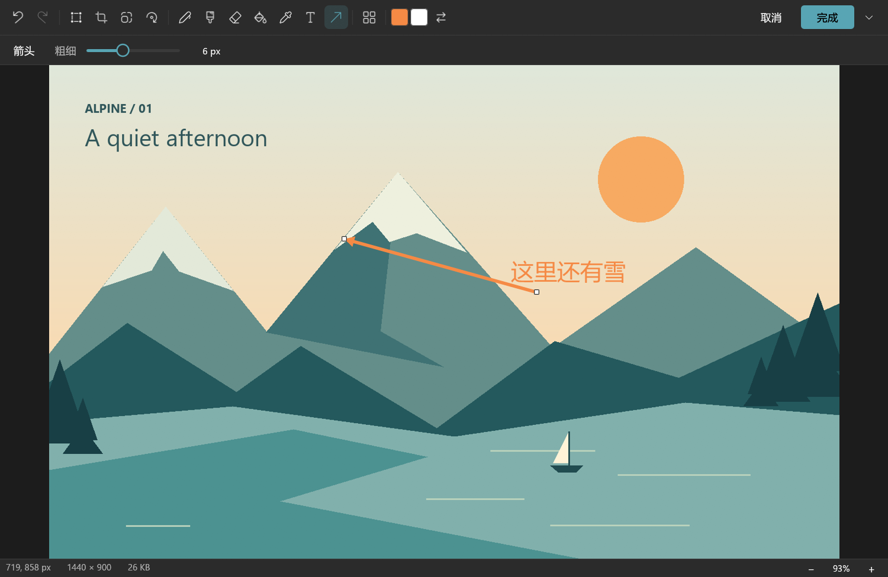
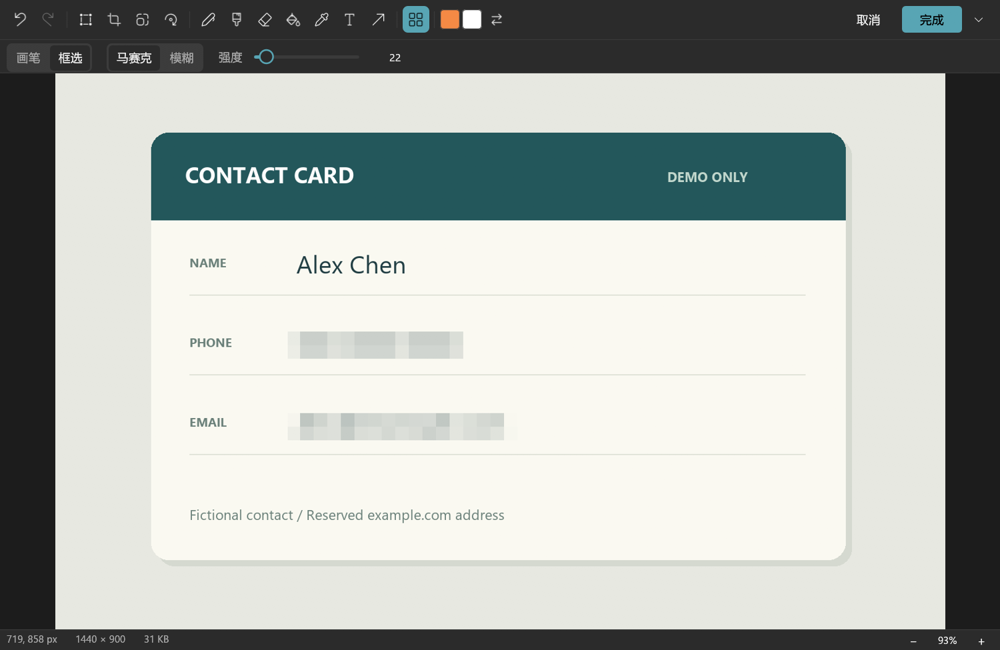
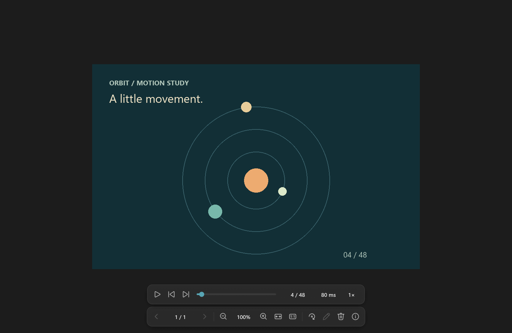

# LiteView 轻量看图

Rust 编写的轻量图片查看器：同文件夹翻图、鼠标滚轮缩放、GIF 自动播放与逐帧查看；
自带画图级编辑，以及马赛克 / 模糊 / 涂抹画笔和框选打码。现代扁平界面，中英文，跟随系统深浅色。

> Windows 上的看图、编辑和打码是主要使用范围；可从 [Microsoft Store](https://apps.microsoft.com/detail/9PCG7D394JFC) 或 [GitHub Releases](https://github.com/Lianzy-Baimiao/LiteView/releases/latest) 安装。还没做完、还没实测的事见 [TODO](docs/TODO.md)。

## v1.7.0 更新（2026-10-30）

- 打开 WebM 表情包（Windows）：Telegram 那样带透明的 VP9 动图，用系统的「VP9 视频扩展」解码，透明的地方显示棋盘格；翻文件夹、打开对话框都认 .webm。
- SVG 放大超过 1:1 不再发虚：停下后按屏幕的像素重画看得见的那块。
- 涂抹画笔顺着拖的方向走（以前总是横的）；框选还是横的。
- 比例菜单的输入框能打字了（以前一点就关、打的字变成快捷键）；无边框窗口在缩放不同的两块屏之间来回后不再变小。
- 竖拍照片（EXIF 转 90°）、16 位图解码更快、更省内存；翻大图文件夹、编辑大图时少占内存。

以前各版本的更新见 [更新日志](docs/CHANGELOG.md)。

## 界面预览

以下截图来自已发布的 Windows 1.0.0 正式版（2026-10-17），不是界面设计稿；之后的版本工具栏平时隐藏，部分按钮和菜单有调整。
图片为原创演示素材，资料卡为虚构数据；文字、箭头和马赛克均由 LiteView 实际操作生成。[截图来源与复现方法](docs/images/store-v1.0.0/README.md)

### 看图 · 深色主题

内容优先，鼠标移到窗口底部时出现浮动工具栏，提供翻图、缩放、旋转与编辑入口。



### 编辑 · 文字与箭头标注

在同一窗口进入编辑，添加中文文字、绘制箭头，并调整形状控制点。



### 打码 · 框选马赛克

框选需要遮挡的区域，可切换画笔或框选、马赛克、模糊或涂抹，并调整强度。



### 动图 · 暂停与逐帧查看

暂停 GIF，前后逐帧查看，也可以单独导出当前帧。



## 功能

- 看图：同文件夹翻图（按住连续翻）、滚轮缩放、锁定缩放、全屏、窗口置顶；Windows 上还有无边框模式（窗口就是图片的大小）和打印。
- 动图：GIF / APNG / 动态 WebP 自动播放、调速、逐帧、导出当前帧，大动图超出缓存时后台按需解码；Windows 上装了系统的「VP9 视频扩展」后能打开带透明的 WebM 表情包。
- 格式：常见位图、SVG（放大后按屏幕重画，不发虚）、JPEG XL、RAW 内嵌预览、PSD 合并图；HEIC / AVIF 等在 Windows 上依赖系统解码扩展。并非任意格式都能无条件打开。
- 编辑：裁剪、缩放、旋转、形状、文字、画笔、撤销重做；动图仅查看，不进入编辑。
- 打码：马赛克、模糊、涂抹，画笔或框选。保存时重新编码，并去掉 EXIF / 缩略图等可能泄露原内容的数据；覆盖前确认、原子写入。
- 运行时离线，无广告、无后台常驻服务；MIT 开源。

## 下载与平台

[Microsoft Store](https://apps.microsoft.com/detail/9PCG7D394JFC) · [最新版本](https://github.com/Lianzy-Baimiao/LiteView/releases/latest) · [全部版本](https://github.com/Lianzy-Baimiao/LiteView/releases) · [安装说明](docs/INSTALL.md) · [隐私政策](docs/PRIVACY.md)

- Windows 10 / 11 x64 优先。商店版由微软签名、自动更新；新版本要等微软审核通过才推送，一般比 GitHub 晚几小时到几天。
- GitHub Releases 提供 Windows 绿色版和当前用户安装包（不需要管理员权限），以及 Linux x64、macOS Intel / Apple Silicon 的包。Linux 和 macOS 的包由 CI 构建并跑单元测试，还没在真机上完整验证。
- 发布包附第三方许可和 SHA-256 校验值。GitHub 上的包没有代码签名，macOS 包没有公证，第一次打开时系统可能拦截，注意事项见安装说明。

## 快捷键

| 操作 | 快捷键 |
|---|---|
| 打开 / 粘贴 | Ctrl+O / Ctrl+V |
| 上一张 / 下一张 | ← / →（按住连续翻） |
| 适应窗口 / 原始大小 | Ctrl+0 / Ctrl+1 |
| 全屏 / 无边框（Windows） | F11 / Ctrl+B |
| 编辑 / 打码 | E / M |
| 复制图片 / 保存 | Ctrl+C / Ctrl+S |
| 打印（Windows） | Ctrl+P |
| 动图播放暂停 / 前后帧 | Space / , / . |
| 图片信息 / 关闭窗口 | I / Esc |

全部快捷键见软件的「设置 → 快捷键」。

## 从源码构建

Rust 1.95+；建议使用当前 stable 工具链。

- Windows 推荐 MSVC 工具链和 Visual Studio C++ Build Tools；GNU/MinGW 的本机路径配置见 [.cargo/config.example.toml](.cargo/config.example.toml)。
- Ubuntu 构建依赖：

```sh
sudo apt-get install libxkbcommon-dev libwayland-dev libxcb-render0-dev libxcb-shape0-dev libxcb-xfixes0-dev
```

```sh
cargo test --locked --release --lib
cargo clippy --locked --release --all-targets -- -D warnings
cargo build --locked --release
```

发布与本地打包流程见 [RELEASING](docs/RELEASING.md)。

## English

LiteView is an offline Rust image viewer with folder navigation, wheel zoom, animated-image playback
and a small Paint-style editor with mosaic / blur / smudge redaction. On Windows it can also print,
open transparent WebM stickers and show an image in a borderless window. Choose English in Settings → General.
Install from the [Microsoft Store](https://apps.microsoft.com/detail/9PCG7D394JFC) or [GitHub Releases](https://github.com/Lianzy-Baimiao/LiteView/releases/latest).
Windows is the primary tested platform; Linux and macOS packaging is included but still needs native validation.
See [installation](docs/INSTALL.md), the [changelog](docs/CHANGELOG.md) (Chinese) and [remaining work](docs/TODO.md).

## License

[MIT](LICENSE). Third-party dependencies and icons retain their own licenses;
see [third-party notices](THIRD-PARTY-NOTICES.md) and the generated LICENSES.html in release packages.
